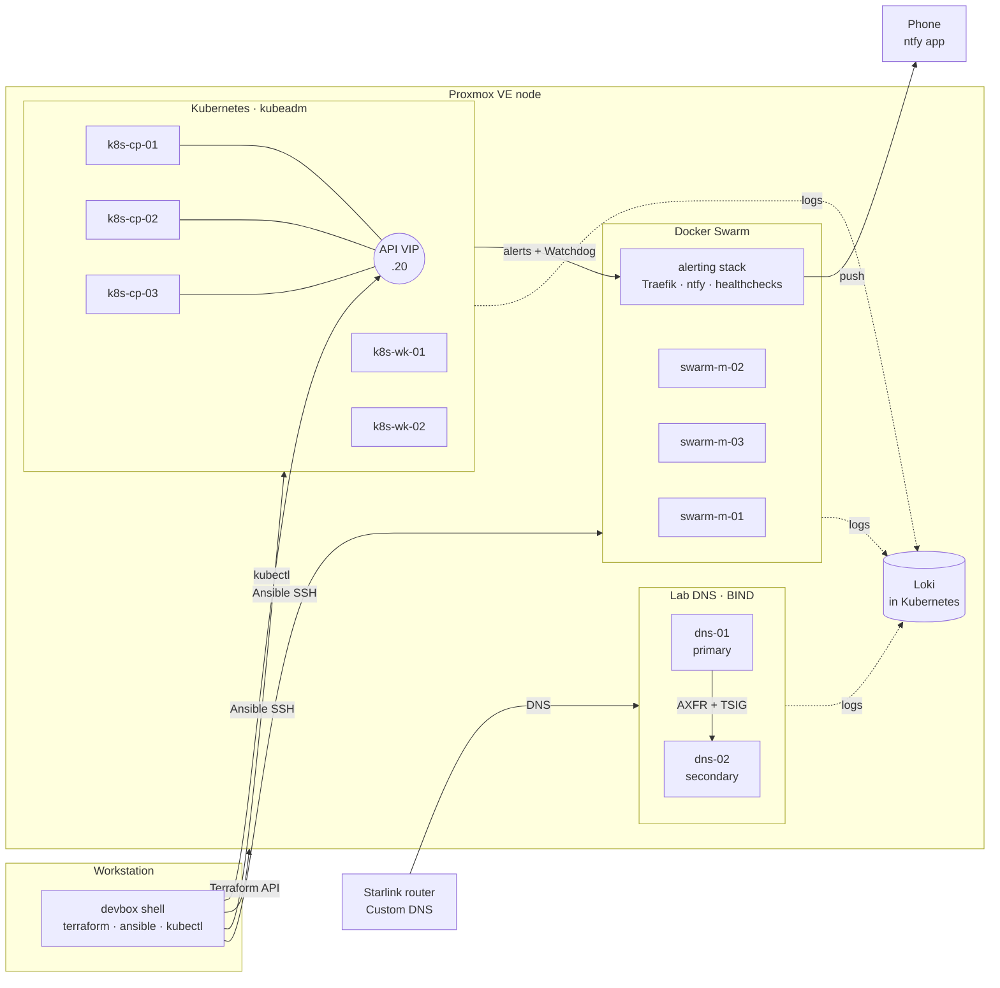

# homelab-infra

[](https://github.com/TheLoomLabs/homelab-infra/actions/workflows/lint.yml)

This repo builds my homelab from code: a highly available **Kubernetes** cluster and a **Docker Swarm** cluster on **Proxmox VE**. Terraform provisions the VMs and Ansible configures them. Everything runs from a reproducible **Devbox** toolchain, so nothing needs to be installed on the workstation.

```
Proxmox VE ──Terraform──▶ 10 Ubuntu VMs ──Ansible──▶ hardened OS ──▶ Kubernetes (kubeadm, HA) ──Argo CD──▶ platform apps
                                                                  ├─▶ Docker Swarm (3 managers)
                                                                  └─▶ BIND DNS (primary + secondary)
```

## What it does

| Layer | Tooling | Highlights |
|---|---|---|
| Toolchain | [Devbox](https://www.jetify.com/devbox) (Nix) | Pinned versions of terraform, ansible, kubectl, helm, cilium, k9s, sops… nothing on the host OS |
| Provisioning | Terraform + [`bpg/proxmox`](https://registry.terraform.io/providers/bpg/proxmox) | Reusable VM module, Ubuntu cloud image import, cloud-init, static IPs, **generated Ansible inventory** |
| OS baseline | Ansible roles `common`, `hardening` | SSH key-only, UFW default-deny, fail2ban, sysctl hardening, IPv6 router advertisements ignored, unattended security updates, rolling reboots (`make reboot`), chrony |
| Kubernetes | Ansible roles `k8s_*`, `cilium` | kubeadm, **3 control-plane nodes behind a kube-vip VIP**, containerd 2.x, **Cilium with kube-proxy replacement**, Hubble, **LB IPAM + L2 announcements** for `LoadBalancer` services |
| GitOps | Argo CD (Helm), role `argocd` | Bootstrapped by Ansible, then **app of apps**: Argo CD syncs `kubernetes/apps/` and manages itself |
| DNS | Ansible role `bind`, BIND 9 | **Primary + secondary on dedicated VMs**, zone from Git with automatic records and serial, **TSIG-signed zone transfers**, DNSSEC-validating resolver for the whole house |
| Ingress & TLS | Cilium Gateway API, cert-manager | One shared **Gateway** on a fixed LAN IP; **Let's Encrypt wildcard cert via Cloudflare DNS-01**, so nothing has to be public |
| Secrets | SOPS + age, sops-secrets-operator, role `sops_age`, `community.sops` | Secrets committed **encrypted**, decrypted in the cluster (Argo CD never sees plaintext) or by Ansible on the workstation; **Secrets and ConfigMaps encrypted at rest in etcd** (secretbox, two-pass rollout, key rotation runbook) |
| Storage | Longhorn, role `longhorn_node` | Replicated block volumes on a dedicated data disk per worker, **LUKS-encrypted default StorageClass**, hourly snapshots and daily/weekly **backups to Cloudflare R2** |
| Backups | Velero + CSI snapshots | Nightly cluster backups to R2 (objects **SSE-C encrypted**), volumes backed up by Longhorn through CSI VolumeSnapshots; restore tested end to end |
| Monitoring | kube-prometheus-stack (Argo CD) | Prometheus, Alertmanager, Grafana; components ship their own ServiceMonitors and rules, **alerts on failed or missing backups**, degraded volumes and the usual cluster health |
| Logs | Loki + Grafana Alloy (Argo CD), role `alloy` | Pod logs, node journals and Kubernetes events from the cluster, **journal and Swarm container logs from the VMs**; 15 days in Loki, queried in Grafana |
| Alerting | Swarm stack: Traefik, ntfy, healthchecks (role `alerting`) | **Self-hosted, no SaaS:** push to the phone via ntfy, **dead man's switch** on healthchecks outside Kubernetes, so a dead cluster is still reported |
| Swarm | Ansible roles `docker`, `swarm`, `alerting` | Docker CE, 3-manager Raft quorum, node labels; Traefik with a wildcard cert for Swarm stacks |
| Quality | GitHub Actions, pre-commit | `terraform fmt/validate`, tflint, yamllint, ansible-lint (production profile), gitleaks, SOPS encryption check; **every Argo CD app rendered and validated** with kubeconform against schemas generated from the pinned CRDs, plus `promtool check rules`, AppProject limits, Pod Security labels and a default-deny network policy per namespace; actions pinned to commit SHAs, self-hosted Renovate, weekly Trivy image scan to code scanning ([docs/ci.md](docs/ci.md)) |

## Architecture



More detail is in [docs/architecture.md](docs/architecture.md). The design decisions are recorded as ADRs in [docs/adr](docs/adr), the plan in [docs/roadmap.md](docs/roadmap.md).

| Runbook | Covers |
|---|---|
| [bootstrap.md](docs/bootstrap.md) | One-time Proxmox preparation |
| [dns.md](docs/dns.md) | Lab DNS: records, checks, TSIG rotation |
| [secrets.md](docs/secrets.md) | Adding, editing and rotating SOPS secrets |
| [storage.md](docs/storage.md) | Longhorn: volumes, encryption key, R2 backups and restores |
| [backup.md](docs/backup.md) | Velero: schedule, restores, disaster recovery |
| [monitoring.md](docs/monitoring.md) | Prometheus, Alertmanager, Grafana: alert routing, checks, testing the alert path |
| [alerting.md](docs/alerting.md) | Swarm alerting stack: ntfy, healthchecks, Traefik; phone setup, rebuild |
| [logging.md](docs/logging.md) | Loki and Alloy: labels, push secret, checks, example queries |
| [maintenance.md](docs/maintenance.md) | Rolling reboots (kernel updates, network changes) |
| [encryption.md](docs/encryption.md) | Encryption at rest for Secrets and ConfigMaps: rollout, checks, key rotation |
| [pod-security.md](docs/pod-security.md) | Pod Security Admission: level per namespace, cluster defaults, adding a namespace |
| [network-policy.md](docs/network-policy.md) | Cilium default-deny policies: what is allowed, audit-mode rollout, reviewing drops |

## Quick start

```bash
# 1. Toolchain (the only thing installed on the workstation is devbox itself)
devbox shell
make setup

# 2. Credentials and settings (git-ignored)
cp .env.example .env                                            # Proxmox API token
cp terraform/envs/homelab/terraform.tfvars.example \
   terraform/envs/homelab/terraform.tfvars                      # network, SSH keys

# 3. VMs
make tf-plan && make tf-apply     # also writes ansible/inventory/hosts.yml

# 4. Configuration
make ping
age-keygen -o .artifacts/age.key  # once, then back it up (docs/secrets.md)
# once: k8s/encryption.sops.yaml, the etcd encryption key (docs/encryption.md)
make site                         # base + DNS + Kubernetes + Longhorn node prep + age key + Argo CD + Swarm + alerting stack + log shipping

# 5. Use it
kubectl get nodes -o wide         # KUBECONFIG is set by devbox
cilium status
kubectl -n argocd get applications

# Argo CD UI on https://argocd.lab.theloomlabs.org (user admin)
kubectl -n argocd get secret argocd-initial-admin-secret -o jsonpath='{.data.password}' | base64 -d; echo
# Lab DNS (docs/dns.md): point the router's DNS, or your workstation, at dns-01 and dns-02.
# Without it: kubectl -n argocd port-forward svc/argocd-server 8080:80 → http://localhost:8080
```

The one-time Proxmox preparation (API token, storage content types) is in [docs/bootstrap.md](docs/bootstrap.md).

## Repository layout

```
.
├── devbox.json                 # pinned toolchain + env (KUBECONFIG, ANSIBLE_CONFIG, SOPS_AGE_KEY_FILE)
├── .sops.yaml                  # which files sops encrypts, and for which age key
├── Makefile                    # entry point: make help
├── renovate.json               # dependency updates (self-hosted Renovate, docs/ci.md)
├── terraform/
│   ├── modules/proxmox-vm/     # one VM: disk import, cloud-init snippet, network
│   └── envs/homelab/           # the lab: node map → VMs → Ansible inventory
├── ansible/
│   ├── playbooks/              # site, base, dns, kubernetes, encryption, pod-security, cilium, longhorn, sops, argocd, swarm, alerting, logs, reboot
│   ├── roles/                  # common, hardening, bind, docker, swarm, k8s_prereqs,
│   │                           # k8s_control_plane, k8s_worker, cilium, longhorn_node,
│   │                           # sops_age, argocd, alerting, alloy
│   └── inventory/group_vars/   # versions and CIDRs
├── dns/                        # lab zone records + SOPS-encrypted TSIG key
├── swarm/                      # SOPS-encrypted secrets of the Swarm stacks
├── logging/                    # SOPS-encrypted push password for Alloy on the VMs
├── k8s/                        # SOPS-encrypted key for encryption at rest in etcd
├── kubernetes/
│   ├── apps/                   # Argo CD Applications + AppProjects (app of apps, synced from main)
│   └── platform/               # Helm values, manifests and *.sops.yaml secrets per component
├── scripts/                    # check-manifests.py (make manifests), scan-images.py (make images), hubble-flows.py
└── docs/                       # architecture, bootstrap, runbooks (dns, secrets, storage,
                                # backup, monitoring, alerting, logging, ci, maintenance, encryption,
                                # pod-security, network-policy), ADRs, roadmap
```

## Security notes

- This is a public repo. Node addresses and domains in the Terraform and Ansible code are placeholders (`192.168.10.0/24`, `lab.example.internal`); real values live in git-ignored `terraform.tfvars` and `.env` files.
- Manifests that Argo CD syncs from GitHub, and the DNS records in `dns/records.yml`, must hold real values. Private LAN addresses (like the LoadBalancer pool in `kubernetes/platform/cilium-lb/`) and the lab domain are committed as is: the addresses are not reachable from outside, and lab hostnames have no public DNS records. Secrets never are.
- Secrets are committed only as SOPS-encrypted `*.sops.yaml` files and decrypted in the cluster by sops-secrets-operator ([docs/secrets.md](docs/secrets.md)). The age private key exists only on the workstation, in an offline backup and in the cluster.
- The API server encrypts Secrets and ConfigMaps in etcd (secretbox, key in SOPS; [docs/encryption.md](docs/encryption.md)).
- Pod Security Admission: every namespace has a level in Git (`restricted` unless it runs node agents), and namespaces without labels default to `baseline`. Apps can't create or relabel namespaces ([docs/pod-security.md](docs/pod-security.md)).
- Every platform and app namespace is default deny for ingress and egress (CiliumNetworkPolicies); internet access only to named hosts ([docs/network-policy.md](docs/network-policy.md)).
- gitleaks runs in CI and pre-commit, `detect-private-key` in pre-commit, and a check rejects unencrypted `*.sops.yaml` files.
- Nodes accept SSH keys only, run a default-deny firewall, and allow cluster traffic only from the lab, pod and service networks.

## License

MIT
