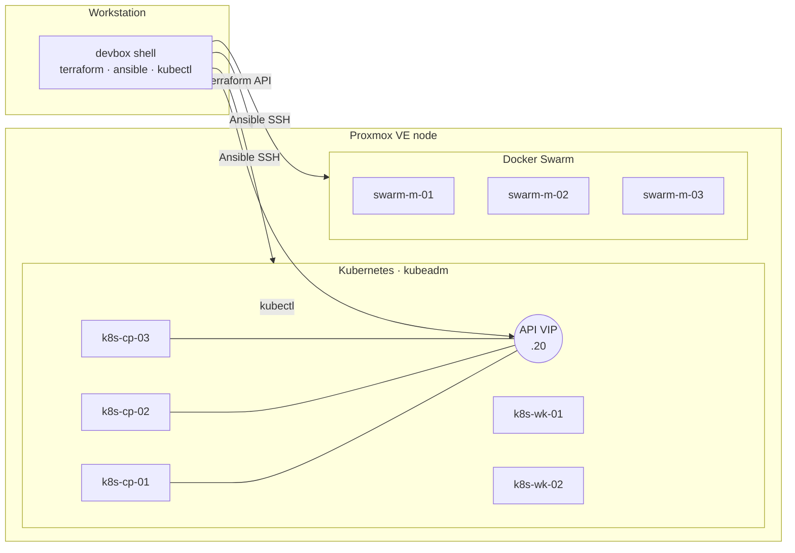

# homelab-infra

[](https://github.com/TheLoomLabs/homelab-infra/actions/workflows/lint.yml)

This repo builds my homelab from code: a highly available **Kubernetes** cluster and a **Docker Swarm** cluster on **Proxmox VE**. Terraform provisions the VMs and Ansible configures them. Everything runs from a reproducible **Devbox** toolchain, so nothing needs to be installed on the workstation.

```
Proxmox VE ──Terraform──▶ 8 Ubuntu VMs ──Ansible──▶ hardened OS ──▶ Kubernetes (kubeadm, HA)
                                                                 └─▶ Docker Swarm (3 managers)
```

## What it does

| Layer | Tooling | Highlights |
|---|---|---|
| Toolchain | [Devbox](https://www.jetify.com/devbox) (Nix) | Pinned versions of terraform, ansible, kubectl, helm, cilium, k9s, sops… nothing on the host OS |
| Provisioning | Terraform + [`bpg/proxmox`](https://registry.terraform.io/providers/bpg/proxmox) | Reusable VM module, Ubuntu cloud image import, cloud-init, static IPs, **generated Ansible inventory** |
| OS baseline | Ansible roles `common`, `hardening` | SSH key-only, UFW default-deny, fail2ban, sysctl hardening, unattended security updates, chrony |
| Kubernetes | Ansible roles `k8s_*`, `cilium` | kubeadm, **3 control-plane nodes behind a kube-vip VIP**, containerd 2.x, **Cilium with kube-proxy replacement**, Hubble, **LB IPAM + L2 announcements** for `LoadBalancer` services |
| GitOps | Argo CD (Helm), role `argocd` | Bootstrapped by Ansible, then **app of apps**: Argo CD syncs `kubernetes/apps/` and manages itself |
| Secrets | SOPS + age, sops-secrets-operator, role `sops_age` | Secrets committed **encrypted**, decrypted in the cluster; Argo CD never sees plaintext |
| Swarm | Ansible roles `docker`, `swarm` | Docker CE, 3-manager Raft quorum, node labels |
| Quality | GitHub Actions, pre-commit | `terraform fmt/validate`, tflint, yamllint, ansible-lint (production profile), gitleaks, SOPS encryption check |

## Architecture



More detail is in [docs/architecture.md](docs/architecture.md). The design decisions are recorded as ADRs in [docs/adr](docs/adr).

## Quick start

```bash
# 1. Toolchain (the only thing installed on the workstation is devbox itself)
devbox shell
make setup

# 2. Credentials and settings (git-ignored)
cp .env.example .env                                            # Proxmox API token
cp terraform/envs/homelab/terraform.tfvars.example \
   terraform/envs/homelab/terraform.tfvars                      # network, SSH keys

# 3. VMs
make tf-plan && make tf-apply     # also writes ansible/inventory/hosts.yml

# 4. Configuration
make ping
age-keygen -o .artifacts/age.key  # once, then back it up (docs/secrets.md)
make site                         # base + Kubernetes + age key + Argo CD + Swarm

# 5. Use it
kubectl get nodes -o wide         # KUBECONFIG is set by devbox
cilium status
kubectl -n argocd get applications

# Argo CD UI on https://localhost:8080 (user admin)
kubectl -n argocd get secret argocd-initial-admin-secret -o jsonpath='{.data.password}' | base64 -d; echo
kubectl -n argocd port-forward svc/argocd-server 8080:443
```

The one-time Proxmox preparation (API token, storage content types) is in [docs/bootstrap.md](docs/bootstrap.md).

## Repository layout

```
.
├── devbox.json                 # pinned toolchain + env (KUBECONFIG, ANSIBLE_CONFIG, SOPS_AGE_KEY_FILE)
├── .sops.yaml                  # which files sops encrypts, and for which age key
├── Makefile                    # entry point: make help
├── terraform/
│   ├── modules/proxmox-vm/     # one VM: disk import, cloud-init snippet, network
│   └── envs/homelab/           # the lab: node map → VMs → Ansible inventory
├── ansible/
│   ├── playbooks/              # site, base, kubernetes, cilium, sops, argocd, swarm
│   ├── roles/                  # common, hardening, docker, swarm, k8s_prereqs,
│   │                           # k8s_control_plane, k8s_worker, cilium, sops_age, argocd
│   └── inventory/group_vars/   # versions and CIDRs
├── kubernetes/
│   ├── apps/                   # Argo CD Applications (app of apps, synced from main)
│   └── platform/               # Helm values, manifests and *.sops.yaml secrets per component
└── docs/                       # architecture, bootstrap, ADRs, roadmap
```

## Security notes

- This is a public repo. Node addresses and domains in the Terraform and Ansible code are placeholders (`192.168.10.0/24`, `lab.example.internal`); real values live in git-ignored `terraform.tfvars` and `.env` files.
- Manifests that Argo CD syncs from GitHub must hold real values. Private LAN addresses (like the LoadBalancer pool in `kubernetes/platform/cilium-lb/`) are committed as is, because they are not reachable from outside. Secrets never are.
- Secrets are committed only as SOPS-encrypted `*.sops.yaml` files and decrypted in the cluster by sops-secrets-operator ([docs/secrets.md](docs/secrets.md)). The age private key exists only on the workstation, in an offline backup and in the cluster.
- gitleaks runs in CI and pre-commit, `detect-private-key` in pre-commit, and a check rejects unencrypted `*.sops.yaml` files.
- Nodes accept SSH keys only, run a default-deny firewall, and allow cluster traffic only from the lab, pod and service networks.

## License

MIT
