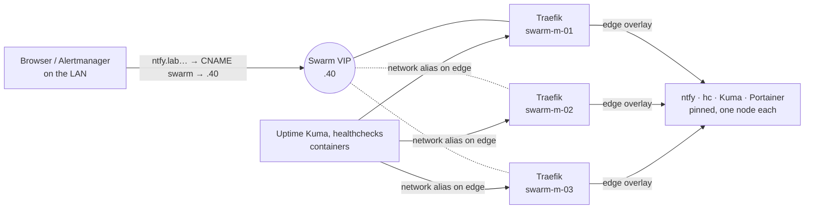

# Swarm edge: VIP, Traefik on every manager, one certificate

Every Swarm web UI (ntfy, healthchecks, Uptime Kuma, Portainer, later Mattermost) is reached through **Traefik**, which runs on all three Swarm managers. A virtual IP held by **keepalived** points at one manager whose Traefik answers, and moves within seconds when that Traefik or its node fails. One Let's Encrypt wildcard certificate serves all three; **edge-cert** keeps it in the Swarm itself. Decision and alternatives: ADR 0017.



| What | Where |
|---|---|
| Role, script, units | `ansible/roles/edge` (`make edge`, playbook `playbooks/edge.yml`) |
| VIP address | `swarm_vip` in the Terraform inventory (`swarm_vip_offset`, default 40) |
| DNS | `swarm A <vip>` and the app CNAMEs in `dns/records.yml` |
| Names Traefik answers for on the `edge` network | `edge_hosts` in `ansible/roles/edge/defaults/main.yml` |
| Cloudflare token (DNS-01) | `swarm/edge.sops.yaml` → `/etc/edge-cert/cloudflare-token` on the managers (root only) |
| Alerts | group `swarm-edge` in `kubernetes/platform/monitoring/vms-prometheusrule.yaml` |

## How it works

### VIP (keepalived)

- keepalived runs on the hosts (apt package, not a Swarm service), so a dockerd restart doesn't take it down. VRRPv3, unicast between the managers' LAN addresses, router ID 41. UFW trusts the LAN, so VRRP (IP protocol 112) passes.
- Every 2 s it curls `http://<node>:8082/ping`, the local Traefik. Two failures put the node in `FAULT`: it gives up the VIP and can't take it. Two successes bring it back as `BACKUP`.
- All nodes start as `BACKUP` with `nopreempt`: the VIP stays where it is until that node fails. A node coming back doesn't take it back (no second switch). On a fresh start the highest priority wins (swarm-m-01).
- The VIP is a `/32` on the main interface, like kube-vip's. The role `common` never runs `netplan apply`, which could drop it.
- A notify script writes the state to Alloy's textfile directory on every change: `keepalived_vrrp_master`, `keepalived_vrrp_fault`, `keepalived_vrrp_state_change_timestamp_seconds` (label `vrrp_instance="swarm_vip"`).

### Traefik

- Stack `edge`, service `edge_traefik`: a global service on the managers (the Swarm provider needs a manager's Docker socket). Ports 80, 443 and 8082 in host mode: no routing-mesh hop, Traefik logs real client addresses, and a node answers only if its own Traefik runs, which is exactly what keepalived checks.
- It routes over the `edge` overlay network to the node an app runs on. The apps stay pinned (their state is in local volumes), so the VIP's node doesn't matter.
- Containers never need the VIP: the app names in `edge_hosts` are network aliases of Traefik on `edge`, so Uptime Kuma, healthchecks or a future app calling `https://ntfy.lab.theloomlabs.org` reach Traefik over the overlay.
- Updates (a new image, a new certificate) restart Traefik one node at a time, stop-first (host ports can't be shared), 20 s apart, with rollback on failure. keepalived moves the VIP off a node while its Traefik restarts.
- Port 8082 serves `/ping` and the Prometheus metrics (job `traefik`, three targets).

### Certificate (edge-cert)

- `/usr/local/bin/edge-cert`, from `edge-cert.timer` on every manager at 04:20 and 16:20 UTC (±20 min). On a node that isn't the Raft leader it does nothing, so there is exactly one issuer whichever managers are up.
- It looks up the newest certificate in the Swarm: Swarm configs labelled `homelab.edge.cert`, named `edge_tls_crt_<sha10>`. It renews when less than a third of the lifetime is left (30 days of a 90-day certificate; shorter Let's Encrypt lifetimes are followed on their own), or when no certificate covers `edge_cert_domains`.
- Renewal: lego (pinned, checked against the release checksums) gets `lab.theloomlabs.org` + `*.lab.theloomlabs.org` with DNS-01 through Cloudflare, checking propagation against public resolvers (BIND answers the lab zone itself). The certificate becomes the Swarm config `edge_tls_crt_<sha10>`, the key the Swarm secret `edge_tls_key_<sha10>` (Raft, encrypted at rest on the managers). lego's local copies are deleted; it keeps only its account under `/var/lib/edge-cert/lego` (one per manager, no e-mail).
- Then `docker service update` swaps the pair on `edge_traefik` (rolling restart) and removes the old pair. Ansible renders the same current pair into the stack file, so `make edge` afterwards changes nothing.
- Metrics (textfile, written by the node that acted): `edge_cert_last_run_timestamp_seconds`, `edge_cert_last_run_success`, `edge_cert_last_success_timestamp_seconds`, `edge_cert_not_after_timestamp_seconds`.

### Alerts

| Alert | Severity | Fires when |
|---|---|---|
| SwarmVipDown | critical | No manager holds the VIP for 2 minutes |
| SwarmVipSplitBrain | critical | More than one manager holds it for 1 minute |
| SwarmVipNodeFault | warning | A manager's Traefik fails the check for 5 minutes: the VIP can't move there |
| EdgeCertRenewalFailing | warning | edge-cert hasn't succeeded on any manager for two days |
| TraefikCertificateExpiringSoon | warning | A Traefik serves a certificate with under 14 days left |
| TraefikCertificateMismatch | warning | The Traefik instances serve different certificates for 2 hours |

With the VIP down, ntfy is unreachable for Alertmanager and the phone: SwarmVipDown is mostly for Grafana afterwards; on the phone it shows as a lost ntfy connection. Uptime Kuma's `swarm-vip` monitor checks the VIP path every minute.

## Set up (once)

These steps move Traefik from the `alerting` stack to `edge`. On a fresh build `make site` does it all (secrets file and `swarm_vip` first).

### 1. Pick the address

The VIP must be free and outside the router's DHCP range. `.40` sits next to the managers (`.41–.43`), like the API VIP `.20` next to the control plane.

```bash
ping -c 2 -W 1 192.168.1.40     # no answer expected
```

### 2. Secrets file

Traefik's existing Cloudflare token (Zone DNS Edit + Zone Read on `theloomlabs.org`) moves from `swarm/alerting.sops.yaml` to its own file:

```bash
CF=$(sops decrypt --extract '["alerting_cloudflare_api_token"]' swarm/alerting.sops.yaml)
printf 'edge_cloudflare_api_token: "%s"\n' "$CF" \
  | sops encrypt --filename-override swarm/edge.sops.yaml --input-type yaml --output-type yaml /dev/stdin > swarm/edge.sops.yaml
unset CF
sops unset swarm/alerting.sops.yaml '["alerting_cloudflare_api_token"]'
make sops-check
```

A new token: Cloudflare → **My Profile** → **API Tokens** → **Create Token** → template **Edit zone DNS**; permissions `Zone / DNS / Edit` and `Zone / Zone / Read`; zone resources `Include / Specific zone / theloomlabs.org`. Then `sops set swarm/edge.sops.yaml '["edge_cloudflare_api_token"]' '"<token>"'`.

### 3. Inventory

```bash
make tf-plan     # only local_file.ansible_inventory changes (swarm_vip)
make tf-apply
grep swarm_vip ansible/inventory/hosts.yml
```

### 4. Deploy

```bash
make edge          # keepalived, lego, first certificate (1-2 min), removes alerting_traefik, deploys edge
make alerting      # alerting without Traefik; removes the old Cloudflare token secret
make dns           # swarm A record, app CNAMEs → swarm
make uptime        # swarm-vip monitor
make swarm-backup  # drops the old traefik backup group
```

Between the removal of `alerting_traefik` and the first `edge_traefik` task the Swarm UIs are down for under a minute. Then push the commits; Argo CD syncs the scrape targets, alerts and dashboard.

### 5. Check

```bash
ssh ops@swarm-m-01.lab.theloomlabs.org docker service ps edge_traefik            # 3 Running, one per manager
ansible swarm_managers -b -m ansible.builtin.shell -a 'ip -br -4 addr | grep -w 192.168.1.40 || true'   # exactly one node
ansible swarm_managers -b -m ansible.builtin.command -a 'cat /var/lib/alloy/textfile/keepalived.prom'
dig +short ntfy.lab.theloomlabs.org           # swarm.lab.theloomlabs.org. then 192.168.1.40
curl -s http://swarm.lab.theloomlabs.org:8082/ping; echo                          # OK
for h in swarm-m-01 swarm-m-02 swarm-m-03; do \
  echo | openssl s_client -connect $h.lab.theloomlabs.org:443 -servername ntfy.lab.theloomlabs.org 2>/dev/null \
  | openssl x509 -noout -serial -enddate; done                                    # same serial three times
curl -s https://ntfy.lab.theloomlabs.org/v1/health; echo                          # {"healthy":true}
ansible swarm_managers -b -m ansible.builtin.command -a 'journalctl -u edge-cert -n 5 --no-pager'
```

### 6. Failover test

Find the holder (step 5), then on it:

```bash
# Traefik dies: the VIP moves within ~4 s, Swarm restarts the task, the node comes back as BACKUP
ssh ops@<holder>.lab.theloomlabs.org 'docker kill $(docker ps -q -f name=edge_traefik)'
# keepalived stops (VRRP priority 0): the VIP moves at once
ssh ops@<holder>.lab.theloomlabs.org 'sudo systemctl stop keepalived; sleep 10; sudo systemctl start keepalived'
```

In another terminal during the test: `while sleep 1; do curl -s -o /dev/null -w '%{http_code} ' https://portainer.lab.theloomlabs.org/api/system/status; done`: at most one or two failed requests. `journalctl -u keepalived` on the nodes shows the transitions.

### 7. Hairpin test

A container that calls the VIP on the node holding it arrives at the host from a Docker bridge. UFW trusts only the LAN, so the role allows `edge_container_cidrs` (172.16.0.0/12, Docker's default bridge pools) to the edge ports. On the VIP holder:

```bash
ssh ops@<holder>.lab.theloomlabs.org docker run --rm curlimages/curl -s -m 5 http://swarm.lab.theloomlabs.org:8082/ping
ssh ops@<holder>.lab.theloomlabs.org docker run --rm --network edge curlimages/curl -s -m 5 https://ntfy.lab.theloomlabs.org/v1/health
```

Both answer (`OK`, `{"healthy":true}`; the second goes through the network alias, not the VIP). If the first times out: `docker network inspect docker_gwbridge bridge --format '{{ .Name }} {{ (index .IPAM.Config 0).Subnet }}'` and check that the subnets are inside `edge_container_cidrs`.

### 8. Clean up (after a few days)

The old ACME volume on swarm-m-01 is unused (its snapshots stay in restic):

```bash
ssh ops@swarm-m-01.lab.theloomlabs.org docker volume rm alerting_traefik-acme
```

## Day to day

- **New Swarm app behind Traefik:** join the external network `edge`, add the Traefik labels under `deploy.labels` (see `ansible/roles/uptime_kuma/templates/compose.yml.j2`), add `{name: <app>, type: CNAME, value: swarm}` to `dns/records.yml` and the name to `edge_hosts`; `make dns edge`.
- **Upgrade Traefik:** bump `edge_traefik_image` (Renovate does), `make edge`. Rolling, one node at a time.
- **Renew now** (testing, after changing `edge_cert_domains`): on any manager `sudo edge-cert /etc/edge-cert/config.json run --here --force`. Mind the Let's Encrypt limit of 5 certificates per week for the same names. To test against staging, set `edge_acme_server: https://acme-staging-v02.api.letsencrypt.org/directory`, `make edge`, `--force`, then back to production and `--force` again.
- **Rotate the Cloudflare token:** `sops edit swarm/edge.sops.yaml`, `make edge`.
- **Reboots:** `make reboot` takes the managers one at a time; the VIP moves off each in turn.

## Troubleshooting

- **The VIP is nowhere (SwarmVipDown):** `docker service ps edge_traefik --no-trunc` (tasks failing: port 80/443 in use by another service, image pull), then `journalctl -u keepalived -n 50` on the managers (`FAULT` = the ping fails: `curl -v http://<node>:8082/ping`).
- **Two holders (SwarmVipSplitBrain):** the adverts don't arrive. `sudo tcpdump -ni <iface> proto 112` on a node should show adverts from the holder every second. Check UFW (`sudo ufw status` must show the LAN as trusted) and that both run the same `virtual_router_id`.
- **A node stays in FAULT:** its Traefik isn't running or doesn't answer on 8082: `docker service ps edge_traefik --filter node=<node> --no-trunc`.
- **edge-cert fails (EdgeCertRenewalFailing):** `journalctl -u edge-cert -n 50` on the leader (`docker node ls`: `Leader`). `403` from Cloudflare: token scope. Propagation timeout: the resolvers in `edge_acme_resolvers` must be public. `too many certificates`: Let's Encrypt's weekly limit; wait.
- **Traefik serves its default certificate:** the dynamic config isn't loaded: `docker service logs edge_traefik 2>&1 | grep -i -E 'tls|certificate|file'`.
- **404 from Traefik:** the app isn't on the `edge` network or its labels are wrong: `docker service inspect <service> --format '{{json .Spec.Labels}}'`.
- **A container can't reach a Swarm name:** add the name to `edge_hosts` (`make edge`), or see the hairpin test.

## Limitations

- Only the entry point is HA. ntfy, healthchecks, Uptime Kuma and Portainer stay pinned to one node each (SQLite, BoltDB). A lost node takes its apps down until it returns or they are restored on another node ([swarm-backup.md](swarm-backup.md)).
- If every Traefik is down, the phone can't reach ntfy: same blind spot as a dead alerting node before.
- A certificate renewal restarts each Traefik once; clients of the VIP holder can see a failed request.
- The certificate and key live in the Swarm's Raft store. A Swarm rebuilt from scratch gets a new certificate on the first `make edge`.
